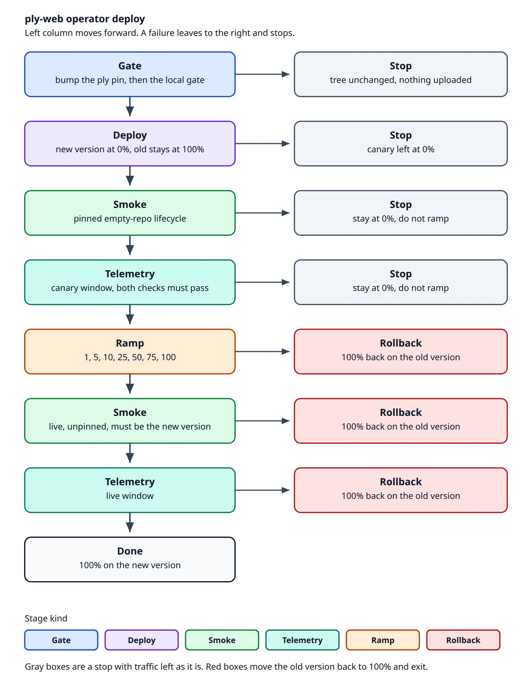

# Continuous deployment

You ship ply-web from a Linux box where `cf` is already logged in. One command uploads the commit you have checked out, smokes it at 0%, then walks traffic from 0% to 100%. Each ramp step sends unpinned probes for 40s and then waits 20s so the telemetry tail is ingested. If a hard gate fails, traffic goes back to the previous version and the command exits. GitHub holds the code and the pull request. It does not deploy.



The left column is the only path that raises traffic. An arrow to the right is that step stopping. A gray box leaves the split as it is. A red box puts the previous version back at 100% and the process exits. A pinned smoke failure takes the gray stop on that row: the canary stays at 0% and the ramp does not start. Source for the picture: [cd-pipeline.mmd](img/cd-pipeline.mmd). The vector file is [cd-pipeline.svg](img/cd-pipeline.svg).

## Before you start

On the box:

- `cf auth login` already done. The login needs Workers Scripts Edit (versions and deployments; an account token calls this Workers Scripts Write), Workers Observability Read, and Artifacts Edit on the namespace below. It does not need routes, KV, R2, or tail.
- `npm ci` in this repo. Node must satisfy `package.json` `engines` (`^22.23.0 || ^24.22.0 || >=26.12.0`). `.nvmrc` is `24.22.1`. `npm run cd` runs `scripts/cd.sh`, which uses `PLY_NODE` if you set it, then `/workspace/node-v24.22.1-linux-x64/bin/node` when that image directory is present, then `node` on `PATH`. If none of those satisfy engines, preflight stops and names that search. It does not judge the Worker. The wrapper prepends the chosen Node's bin directory to `PATH` before exec. `cf` is `#!/usr/bin/env node`, so a v20 `node` left earlier on `PATH` used to make `cf` fail and the run record `harness_fault`.
- `git config user.name` and `user.email` set only when a bump actually commits. An unchanged pin, and `--no-bump`, do not need them. The bump does not push.
- A clean work tree. Deploy refuses a dirty one.
- `HEAD` equal to `origin/main` after `git fetch origin main`. Deploy refuses any other commit (`not-on-origin-main`) and uploads nothing.
- The Worker bearer in `~/.ply-token` (the `PLY_TOKEN_FILE` default), mode `0600` (no group or other bits). The file is read, never printed. Set `PLY_TOKEN_FILE` only to point somewhere else.
- Namespace `ply-loadgen` already exists. The smoke does not create it.

```sh
touch "$HOME/.ply-token" && chmod 0600 "$HOME/.ply-token"
# paste the bearer into that file. That path is the default; export PLY_TOKEN_FILE only to override it.
```

Do not run `npm run worker:deploy` while this is in progress. It refuses unless `PLY_FORCE_FULL_DEPLOY=1`. With that set it sends the Worker to 100% in one shot and will replace the split you are ramping. GitHub does not bump the pin and does not deploy.

Optional overrides (anything you do not set keeps the default in the table further down):

| Variable | Default | What it changes |
| --- | --- | --- |
| `PLY_WORKER` | `ply` | Worker name |
| `PLY_BASE_URL` | `https://ply.ivar.workers.dev` | Where smoke sends HTTP |
| `PLY_ARTIFACTS_NAMESPACE` | `ply-loadgen` | Scratch repos for the empty-repo smoke |
| `PLY_BUMP_BRANCH` | `bump-ply` | Local branch for a pin commit. Not pushed. |
| `PLY_TOKEN_FILE` | `~/.ply-token` | Worker bearer, mode `0600`. Read, never printed |
| `PLY_CD_RUN_DIR` | `~/.local/state/ply-cd/runs` | Where the run directory is created |
| `PLY_SHA` | ply `main` | 40-hex pin, instead of resolving ply `main` |
| `PLY_CD_LEDGER` | `~/.local/state/ply-cd/ledger.jsonl` | Append-only event ledger across runs |

The rollout itself is `scripts/cd/cd.policy.json`: the steps (percent and dwell), the ingest wait, the optional warm-up, the probe rate and mix, which signals are hard or informational, the burn multiple and sample floor, and the routed-share band. `npm run cd -- --policy <path>` uses another file for that run. The engine rejects a file that cannot be run (steps that do not increase, a last step that is not 100, `latency` set to `gate` without thresholds, a share band with `z` of 0). Every run appends a `policy` event with the file's sha256 and the body that ran. `PLY_RAMP_PERCENTS`, `PLY_RAMP_DWELL_MS`, `PLY_RAMP_PROBE_RPS`, `PLY_RAMP_MAX_HOLDS`, and `PLY_RAMP_MIN_REQUESTS` are rejected if set.

## The whole run

From a clean checkout of the commit you want to ship:

```sh
npm run cd
```

You can pin ply to a sha you already know. The command is `cd`; `--sha` on its own is the same run:

```sh
npm run cd -- cd --sha 1274f2dd05b83d70f8d421cdcc79628692d848df
npm run cd -- --sha 1274f2dd05b83d70f8d421cdcc79628692d848df
```

Running the same sha again is safe. The command reads the current deployment and the version tagged with that sha, records the observation, and decides the next stage (rule `reconcile`):

| What is live | Next |
| --- | --- |
| No version tagged with the sha | Upload, then pin it at 0% |
| That version at 0% | Pinned smoke, then telemetry |
| That version at a ramp percent | Ramp onward from that percent |
| That version at 100% | Live smoke, then telemetry |
| Live smoke already passed for that version | Done |

A re-entry appends `resumed` on the unfinished run directory for that sha and keeps the same run id. A finished run starts a new one. Each smoke mints a fresh repo and a fresh token. Every traffic write still compares the deployment to the split it expects, and does not write when they differ.

`--no-bump` skips the pin and deploys the checkout as it is. The run records that as a decision (`no_bump`, outcome `advance`). `--sha` may be passed with it only when that sha is already the pin; a different sha is an argument error.

```sh
npm run cd -- --no-bump
npm run cd -- cd --no-bump
npm run cd -- --sha <current pin> --no-bump
```

What prints, in order:

```text
run: ~/.local/state/ply-cd/runs/2026-10-31T21-05-00-123Z
version: 8c1af0e2-7b3d-4c1a-9e20-6f0a1b2c3d4e
previous: 1aa0bb11-2222-4333-8444-555566667777
ramp step=1/5 percent=10 previous=90 samples=200/1800 error_rate=0.0000/0.0000 routed_share=10.00 target=10 tolerance=7.99..12.01 agg=2000 p99_wall_ms=88/74 p99_cpu_ms=12/11 latency=informational decision=advance
…
cd: PASS 8c1af0e2-7b3d-4c1a-9e20-6f0a1b2c3d4e
```

`version` is the upload you just created. `previous` is the version that was alone at 100% and is the rollback target. `run` is the directory that has the CSV, the telemetry note, and the ramp lines. The last line is the verdict.

| Last line | Exit | What happened |
| --- | --- | --- |
| `cd: PASS <version id>` | 0 | The new version is at 100%, and the live smoke and telemetry passed. |
| `cd: FAIL <stage>: <reason>` | 1 | That stage stopped the run. If the line is from ramp or from the live checks, traffic is already back on `previous` unless the line says the rollback itself failed. |
| `cd: harness_fault <stage>: <reason>` | 1 | A request got no response, a revoked Artifacts token did not get 403, or a check could not be evaluated (the telemetry query, a span-query shape mismatch, zero samples where samples are required, an implausible span join, a preflight miss). The split is unchanged. This is not a change failure. |
| `cd: state_conflict <stage>: <reason>` | 1 | The deployment was not the expected prior split, so the write was skipped. The split is unchanged. |
| a usage line, no `cd: PASS` / `cd: FAIL` | 2 | The arguments were wrong. Traffic was not touched. |

A failing run still writes the directory. Relay the last line and the ramp lines from that directory.

Stages, alone, use the same last-line shape. `npm run cd -- help` lists them.

## 1. Bump

```sh
npm run cd -- bump
npm run cd -- bump --sha <40 hex>
```

Fetches `origin main` and reads that commit's `package.json`. Resolves ply `main` (or the sha you passed). When the pin already matches, it leaves your checkout where it is. When it does not, it commits **only** `package.json` and the lockfile on `bump-ply`, whose parent is `origin/main`, and checks that branch out. The pull request is that one commit. It is not stacked on the branch you were on. It does not push. If you were already on `bump-ply`, that branch is reset to `origin/main` before the commit. `user.name` and `user.email` are read only when that commit is about to be made.

Pass, already pinned:

```text
cd: PASS bump unchanged 1274f2dd05b83d70f8d421cdcc79628692d848df
```

Pass, new local commit:

```text
cd: PASS bump 1274f2dd05b83d70f8d421cdcc79628692d848df
```

Fail (nothing committed; the two files are restored):

```text
cd: FAIL bump: tracked files are modified; bump wants a clean tree
cd: FAIL bump: npm test failed: …
```

You push `bump-ply` yourself if you want a pull request for the pin. Deploy runs only when `HEAD` is `origin/main`, so the pin commit is not uploaded until it has been merged there.

## 2. Deploy the canary

```sh
npm run cd -- deploy-canary
```

Fetches `origin main` first. Unless `HEAD` is that commit, it stops with `not-on-origin-main` (or `origin-main-unavailable` when the fetch fails), writes that typed error on the run, and uploads nothing. Otherwise it builds and uploads a version with `cf workers versions create`. The version id is the row in `cf workers versions list` whose tag is the 12-character HEAD sha. The full pipeline (`--sha`) tags the version with that sha instead, and reuses the version when the tag is already there. The create command's own text is not parsed. A missing tag stops before traffic changes. It then routes that version to **0%** beside the single version that is at 100%, and only when the deployment is still the split it just read. A mismatch stops with `state_conflict` and leaves the split alone. It will not upload into a 50/50 split, a deployment with more than two versions, or a version that is already the live one. If a different version is already sitting at 0%, that slot is replaced. The new version is never given traffic here.

Pass:

```text
version: 8c1af0e2-7b3d-4c1a-9e20-6f0a1b2c3d4e
previous: 1aa0bb11-2222-4333-8444-555566667777
cd: PASS deploy-canary 8c1af0e2-7b3d-4c1a-9e20-6f0a1b2c3d4e
```

The command then waits until five `GET /` requests in a row, sent with `Cloudflare-Workers-Version-Overrides: ply="<new>"`, come back with `x-ply-version` equal to the new id.

Fail, pin never stuck. The 0% version stays in the deployment. The old version is still at 100%. Traffic was not raised, and it was not rolled back, because there is nothing to undo:

```text
cd: FAIL deploy-canary: pinned requests were not answered by 8c1af0e2-7b3d-4c1a-9e20-6f0a1b2c3d4e; left the 0% canary in place
```

Fail, the deployment after create is not 0/100. The previous version is put back at 100% alone:

```text
cd: FAIL deploy-canary: 8c1af0e2-… is at 10%, wanted 0%
```

## 3. Smoke

Pinned (the canary). Every request sends the version override, and every response must carry that same id in `x-ply-version`:

```sh
npm run cd -- smoke --version 8c1af0e2-7b3d-4c1a-9e20-6f0a1b2c3d4e
```

Live (after the ramp, or any time you want to see who is actually serving). No override. `x-ply-version` must still be that id, which is how you know traffic moved:

```sh
npm run cd -- smoke --expect-version 8c1af0e2-7b3d-4c1a-9e20-6f0a1b2c3d4e
```

The smoke creates an **empty** repo in `ply-loadgen` (prefix `ply-web-cd-`). Repo create returns a token. That auto-created token is revoked before the smoke mints its own write token, and the revoked bearer is checked with a `GET` of the repo's `info/refs`: Artifacts must answer 403. The smoke then mints a write token and replays the git lifecycle over `/v1`. It does not seed the repo with stock git. The minted token is revoked after those requests finish and checked the same way. Each check is a `request` event (method, url, status). The token is not in the event, the URL, or the run directory. On a pass the repo is deleted. On a fail the repo name is in the verdict and the token is still revoked. A request that gets no response, a 403 naming that token as invalid or expired, or a revoke that does not stick as 403, stops the run as `harness_fault`. The split stays where it is. The operator decides what to do next. There is no retry and no rollback for that fault.

A 409 is a pass when that step expects it. The ones that matter after the current write API:

- Cherry-pick or revert of a patch that is already on the target, with the same adds and deletes, is `200` `empty`.
- Cherry-pick of that patch onto a target that also has its own extra file is `409` `merge_conflict`. `allowEmpty` does not turn that into a commit. Revert of the picked commit onto a branch that then added an unrelated file is `200` `revert`.
- A merge may stamp author and committer as two different people.
- `from` and `onto` may be a 40-hex commit. Forty zeros is `400` and pushes nothing.

Pass:

```text
cd: PASS smoke 8c1af0e2-7b3d-4c1a-9e20-6f0a1b2c3d4e
```

Fail. The step name is first. The repo is left so you can look, without a token:

```text
cd: FAIL smoke: cherry-wider: status 200, wanted 409; repo ply-web-cd-20261031210500-ab12cd
```

`smoke.csv` in the run directory is one row per request. `pass` is the step verdict, not the HTTP status. A row with status 409 and `pass` is an expected conflict. Columns: `step`, `method`, `path`, `status`, `ms`, `pass`, `cf_ray`, `x_ply_request_id`, `x_artifacts_ray`, `x_ply_version`, `x_ply_build`, `server_timing`, `detail`. The token is not in the file.

On a full `npm run cd`, a smoke failure leaves the canary at 0%. The ramp does not start. Nothing is rolled back: the previous version is already at 100%. The smoke CSV is still written. Telemetry for that canary does not run.

## 4. Telemetry

```sh
npm run cd -- telemetry --version 8c1af0e2-7b3d-4c1a-9e20-6f0a1b2c3d4e \
  --since 2026-10-31T21:05:00Z \
  --report ~/.local/state/ply-cd/runs/2026-10-31T21-05-00-123Z/smoke.json
```

`--since` is the start of the smoke window (ISO-8601, epoch milliseconds, or epoch seconds). The report is the smoke JSON from the same run. The check queries `cf o11y telemetry query` for that version in that window.

It fails when any of these are true:

- an exception, a non-ok invocation, a 5xx, or an error log on that version
- a smoke id logged by a different version
- smoke ids missing from telemetry beyond the loss allowance in `scripts/canary-verdict.mjs` (max of 2 and 2% of the ids). An id the smoke did not see answered by this version is never waived
- a response status the smoke did not expect
- an exception, a 5xx log, a non-ok outcome, or an error log
- wall, CPU, or upstream `fetch` span p50/p99 over the ceilings below, on samples the query returned

A 409 the smoke expected is not an unexpected status. A 500 the smoke did not expect is.

Pass prints the verdict line, then:

```text
telemetry: 40/42 matched, 2 lost (tolerated)
cd: PASS telemetry 8c1af0e2-7b3d-4c1a-9e20-6f0a1b2c3d4e
```

Fail:

```text
cd: FAIL telemetry: telemetry: 0/42 matched FAIL: 42 lost without x-ply-version … recorded by the smoke
```

`telemetry.md` in the run directory is that verdict plus the percentiles. `telemetry.json` is the machine-readable pass or fail. The ramp will not move traffic unless that file is a pass for this version.

Ceilings for this smoke (a tiny repo, cold isolates included; tighten them after a few real runs):

| | p50 | p99 |
| --- | --- | --- |
| Worker wall | 4000 ms | 25000 ms |
| Worker CPU | 250 ms | 3000 ms |
| Artifacts `fetch` span | 2000 ms | 15000 ms |

Span events have `$metadata.requestId` null. They carry `traceId` and `rayId`. The smoke CSV records each request's `cf-ray`, and the join uses that ray, then `traceId` when the ray does not match. A request id still on a span is only a last resort.

The traces view returns one summary row per trace (`traceId`, a span count, a duration, a root span name) and no child spans. Outbound `fetch` durations come from a second query, `view: events` with `$metadata.type = span`. On those events the duration is `source.durationMS` and an Artifacts call has `source.name` `fetch` with a path ending in `git-upload-pack`, `git-receive-pack`, or `info/refs`.

A check the harness cannot evaluate is `harness_fault`: the query threw, the span join matches implausibly few of the invocations the worker logged, or the span query came back as trace summaries. The split stays where it is. There is no rollback and no retry. That result is not a worker fault. A 5xx, an exception, an error log, or a non-ok outcome is a worker fault, because the value was observed. A wall, CPU, or fetch percentile over the ceiling above is a worker fault only when the policy's latency mode is `gate`. The checked-in policy is `informational`, so those percentiles are printed and do not fail the stage. A missing latency series is a harness fault only in `gate` mode.

## 5. Ramp

Only after the pinned smoke and the telemetry file are both a pass for this version, and the deployment is still new-at-0% / previous-at-100%. An empty split, a percent that is not an integer 0–100, or two copies of one version id is refused before `cf` is called:

```sh
npm run cd -- ramp --version 8c1af0e2-7b3d-4c1a-9e20-6f0a1b2c3d4e \
  --previous 1aa0bb11-2222-4333-8444-555566667777 \
  --verdict ~/.local/state/ply-cd/runs/2026-10-31T21-05-00-123Z/telemetry.json
```

Without `--verdict`, or with a verdict that is not a pass for that version, the command exits and does not change traffic.

The checked-in steps are `10, 25, 50, 75, 100`, each with a `40000` ms dwell. The list is only in the policy file. After the dwell the step waits `ingestWaitMs` (`20000` in the checked-in file) and then queries. Smoke id-matching still uses `TELEMETRY_WAIT_MS` (`60000`); that budget is not the ramp wait. `warmupMs` is `0`. Set it above 0 to pause after the split is applied and before the probes, and that pause is not part of the judged window.

The only pinned traffic is the 0% gate: the lifecycle smoke and the deploy check, both sent with `Cloudflare-Workers-Version-Overrides`. From the first ramp step on, probes are ordinary requests. They do not set that header, and they do not pin the old version to balance the arms. Right now those requests are the only load. Real users would be judged by the same telemetry.

During the probe the ramp calls at `probe.rps` (25) ticks per second, once per entry in `probe.calls`: `GET /` (the usage text, no bearer) and `GET /v1/discover`, which the engine requests as `/v1/discover?remote=…` for the public `ply` mirror with the bearer from `PLY_TOKEN_FILE`. That is 50 requests per second. Ticks overlap, up to one second of them in flight, so a response slower than `1000 / rps` ms does not stretch the dwell. There is no `/health` route. The response's `x-ply-version` is written on the request event. It is not the gate. A probe that gets no response stops the ramp as `harness_fault` and leaves the current split in place. Before each percentage change the ramp reads the deployment and writes only when it is still the previous step's split. Otherwise it stops with `state_conflict` and does not roll back.

Five dwells are 200s. Five ingest waits are 100s. A clean ramp is about 5 minutes plus the queries. The 20s wait is the tail measured on run `2026-11-01T00-10-02-620Z`: the query ran about 1.4s after the dwell and the newest event was still 12640ms behind the dwell end at 1% and 17313ms behind it at 5%. `20000` is above that. Those two steps are no longer in the file; the lag is.

Then it reads one `cf o11y` events query for the whole worker over that step's window, and partitions it by `$workers.scriptVersion.id`. The new version, the old version, and the aggregate (every invocation in the window, which is what users feel) are judged separately. Child spans are a second events query with `$metadata.type = span`, not the traces view. Span events have no `$workers.scriptVersion.id` and a null `$metadata.requestId`, so they are queried by service and joined on `rayId`, then `traceId`.

The step decision is the policy. A signal set to `hard` rolls back. The same signal set to `informational` is named on the advance reason and does not roll back. Burn rate is `(bad / total) / (1 − target)`. Definitions are in [Metrics](#metrics). The checked-in file:

| Signal | Checked-in mode | What happens |
| --- | --- | --- |
| Smoke | `hard` | The 0% lifecycle only. A ramp probe's HTTP status is not a gate |
| Exception, 5xx, error log, non-ok outcome | `hard` | Any, on the new version, on the old version, or across the worker. One request is enough |
| SLO burn | `hard` | The same three scopes. `bad/total` divided by the error budget is above `burn.fastBurn` (**14.4**), and that SLO saw at least `burn.minSamples` (**100**) requests |
| Routed share | `rollback` | `routedNewShare` outside the binomial band. `split.onMismatch` may instead be `hold`, which leaves the split |
| Thin evidence | `hold` | Fewer than `split.minNewRequests` (**100**) new-version invocations, or no invocations at all. Outcome `insufficient_data`. `onInsufficient: advance` moves on and still says so |
| Latency | `informational` | Never, under this file. Wall p99 and CPU p99 are on the line and on the ramp observation. `off` omits them from the line. `gate` needs `minSamples`, `p99Ratio` (> 1), and `effectFloorMs`, and rolls back only when both sides have that many wall samples and p99 clears both thresholds |
| Query failed | always | `harness_fault`. The split stays. A missing query is not zero errors and is not a rollback |

### How many requests that is

Correctness here is zero tolerance: one exception, 5xx, error log, or non-ok outcome fails the scope that saw it. With zero observed errors in `n` requests, the error rate `p` at which a step has a 95% chance of seeing at least one is

```text
(1 − p) ^ n = 0.05
p = 1 − 0.05 ^ (1 / n)
```

That `p` is the minimum detectable error-rate change from a clean baseline. The rule of three, `3 / n`, is the same bound at these sizes.

The checked-in probe schedules `25 × 2 × 40s = 2000` requests a step. The smallest open step is 10%, so the new version's expected count is `2000 × 0.10 = 200`. The old version's smallest expected count is the 25% left at the 75% step, 500. At 100% the old version is not allocated.

| Scope | Expected n | Detectable error rate |
| --- | --- | --- |
| New version at 10% | 200 | 1.49% |
| Floor, `minNewRequests` and `burn.minSamples` | 100 | 2.95% |
| Old version at the 75% step | 500 | 0.60% |
| New version at 50% | 1000 | 0.30% |
| Aggregate, and the new version at 100% | 2000 | 0.15% |

A step with fewer than 100 new-version invocations does not advance. That floor is the 2.95% row. A normal 10% step sees about 200 and can catch a 1.5% regression on the new version. The aggregate, which is what users feel, can catch 0.15% in the same window. Per-version is what keeps a regression on the small arm from being diluted into the aggregate.

The share check is the same `n`. For target proportion `p` and `z = 3`, the band is `p ± z √(p(1−p)/n)`. At 10% and `n = 2000` that is 7.99%..12.01%. At 100%, `p(1−p)` is 0, so the share has to be 100%. Counts come from telemetry fetch invocations, not from the probe's own bookkeeping. `test/fixtures/cd/routed-share.json` is a synthetic 10% window of this shape: 200 of 2000 advances, 1000 of 2000 rolls back, 40 of 400 is `insufficient_data`.

This probe is a scaled model of production. At about 800 requests per second, a 40s dwell already holds 32000 requests and the 10% arm holds 3200, which can see about a 0.09% error rate. Retune `probe.rps`, `burn.minSamples`, and `split.minNewRequests` in the policy. When real traffic is the load, `probe.rps` can go to 0 and the same gates read whoever called the worker. That is a config change.

`samples=` on a ramp line counts fetch invocations (`$metadata.type` `cf-worker-event`, `$workers.eventType` `fetch`), new / old, in this window. `agg=` is the unfiltered count, the share denominator. Each request also writes a `ply.request` log, so the event page is about twice the sample count. The query asks for `limit` 1000 and follows the cursor. On the 2026-11-01 run a page came back short because the index held about 28s of the 40s dwell, not because of a 1000-row cap. The window's `to` is the dwell end plus `60000` ms so the tail is inside the query. The ingest wait is what keeps the next step's probes out of this step's judged window.

At 100% the old version is dropped, so its wall and CPU numbers are the last step whose old version had at least 5 wall samples. That line includes `previous_sample=carried`. If no earlier step had them, 100% still advances when the new version is clean.

Comparing versions on trace latency, and leaving cold starts out of that compare, waits until the rollout itself is trusted. The events this ramp reads have no cold-start or isolate-start field. `$workers` carries `wallTimeMs` and `cpuTimeMs`, plus outcome, execution model, and version. This policy does not try to drop cold starts.

Each step prints one line to stdout and appends the same line to `ramp.jsonl` in the run directory. Relay those lines as they appear.

A clean ramp:

```text
ramp step=1/5 percent=10 previous=90 samples=200/1800 error_rate=0.0000/0.0000 routed_share=10.00 target=10 tolerance=7.99..12.01 agg=2000 p99_wall_ms=88/74 p99_cpu_ms=12/11 latency=informational decision=advance
ramp step=2/5 percent=25 previous=75 samples=500/1500 error_rate=0.0000/0.0000 routed_share=25.00 target=25 tolerance=22.10..27.90 agg=2000 p99_wall_ms=90/76 p99_cpu_ms=12/11 latency=informational decision=advance
ramp step=3/5 percent=50 previous=50 samples=1000/1000 error_rate=0.0000/0.0000 routed_share=50.00 target=50 tolerance=46.65..53.35 agg=2000 p99_wall_ms=94/78 p99_cpu_ms=13/12 latency=informational decision=advance
ramp step=4/5 percent=75 previous=25 samples=1500/500 error_rate=0.0000/0.0000 routed_share=75.00 target=75 tolerance=72.10..77.90 agg=2000 p99_wall_ms=101/80 p99_cpu_ms=14/12 latency=informational decision=advance
ramp step=5/5 percent=100 previous=0 samples=2000/0 error_rate=0.0000/- routed_share=100.00 target=100 tolerance=100.00..100.00 agg=2000 p99_wall_ms=114/84 p99_cpu_ms=15/13 latency=informational decision=advance previous_sample=carried
cd: PASS ramp 8c1af0e2-7b3d-4c1a-9e20-6f0a1b2c3d4e
```

How to read a line:

| Field | Meaning |
| --- | --- |
| `step=2/5` | Second percentage. 1-based. The count is the policy's step list. |
| `percent=25` `previous=75` | Configured new-version share, and what is left on the old one. At the last step `previous=0`. |
| `samples=500/1500` | Fetch invocations in this step's window, new / old. |
| `error_rate=0.0000/0.0000` | Non-ok rate, new / old, four decimal places. |
| `routed_share=25.00` | `100 × new / agg`. Null (`-`) when `agg` is 0. |
| `target=25` | The step's percent. The same number as `percent`. |
| `tolerance=22.10..27.90` | The binomial band in percent, `z` standard errors at this `agg`. `-` when `agg` is 0. |
| `agg=2000` | Fetch invocations in the window, every version. |
| `p99_wall_ms=90/76` | Wall-time p99 in milliseconds, new / old. `-` means that side had no sample. Omitted when latency mode is `off`. |
| `p99_cpu_ms=12/11` | CPU p99, new / old. Informational under the checked-in policy, same as wall. |
| `latency=informational` | The percentiles are recorded. They do not roll back. `gate` would. |
| `decision=advance` | No hard signal fired, the share is inside the band, and the new version had enough invocations. |
| `decision=rollback` | A hard signal fired, or the share is outside the band and `onMismatch` is `rollback`. Traffic goes back to the previous version. |
| `decision=insufficient_data` | The new version had fewer than `minNewRequests` invocations (or the window had none) and `onInsufficient` is `hold`. The split stays. |
| `decision=hold` | The share is outside the band and `onMismatch` is `hold`. The split stays. The checked-in file rolls back instead. |
| `reason="…"` | Present on rollback, hold, insufficient evidence, `harness_fault`, and an advance that names an informational signal. Relay it with the line. |
| `previous_sample=carried` | The old-version p99 is from the last step that had at least 5 wall samples. The sample counts on that line are still this window. |

A large wall shift advances. The 2026-11-01 5% walls (`test/fixtures/cd/ramp-5pct-walls.json`, run `2026-11-01T00-10-02-620Z`) do not roll back on latency. So does a step whose p99 is 27ms against 12ms. `insufficient_data` now means the new version was not seen enough times. It is not the old latency compare. Relay it: nothing was rolled back, and the split did not advance.

An exception on the new version, even with one request:

```text
ramp step=1/5 percent=10 previous=90 samples=1/1999 error_rate=1.0000/0.0000 routed_share=0.05 target=10 tolerance=7.99..12.01 agg=2000 p99_wall_ms=40/70 p99_cpu_ms=8/9 latency=informational decision=rollback reason="1 exception on the new version"
cd: FAIL ramp: 1 exception on the new version
```

A 10% step whose telemetry shows about half the traffic on the new version:

```text
ramp step=1/5 percent=10 previous=90 samples=1000/1000 error_rate=0.0000/0.0000 routed_share=50.00 target=10 tolerance=7.99..12.01 agg=2000 p99_wall_ms=80/80 p99_cpu_ms=12/12 latency=informational decision=rollback reason="routed share 50.00% is outside 7.99..12.01 of target 10% (n=2000)"
```

`cf o11y` down stops the ramp as `harness_fault`. It does not roll back and it does not wait:

```text
ramp step=1/5 percent=10 previous=90 samples=-/- error_rate=-/- routed_share=- target=10 tolerance=- agg=0 p99_wall_ms=-/- p99_cpu_ms=-/- latency=informational decision=harness_fault reason="telemetry unavailable: …"
cd: harness_fault ramp: telemetry unavailable: …
```

If the rollback request itself does not stick, the last line says so and names the version that should be at 100%. Do not treat that run as rolled back. Put it back yourself with the command in the next section.

## 6. After 100%

`npm run cd` does not stop at the last ramp line. It smokes again with **no** version override (`--expect-version`), then runs telemetry on that live window. Both have to pass.

Pass is the same `cd: PASS <version id>` as the whole run.

Fail rolls back to `previous` at 100% and exits:

```text
cd: FAIL smoke: read-readme: x-ply-version 1aa0bb11-…, wanted 8c1af0e2-…
cd: FAIL telemetry: telemetry: … 3 5xx
```

Organic 5xx on the new version during the live window fails this telemetry check and rolls back. The canary check was only the pinned smoke ids. The live check is every invocation of that version in the window.

## Rollback

Any time, including when a ramp or a live check did not put the old version back:

```sh
npm run cd -- rollback --to 1aa0bb11-2222-4333-8444-555566667777
```

`--to` is the **good** version. It becomes the only version, at 100%. The command reads the deployment back and will not print a pass unless that is what it sees.

```text
cd: PASS rollback 1aa0bb11-2222-4333-8444-555566667777
cd: FAIL rollback: rollback to 1aa0bb11-… failed: …
```

## The run directory

`~/.local/state/ply-cd/runs/<timestamp>/` (`PLY_CD_RUN_DIR`; an older checkout used `cd-runs/`, which is still gitignored):

| File | What you open it for |
| --- | --- |
| `verdict.json` | `{ "kind": "pass", "version": "…", "failures": [] }`, `kind: "fail"` with `stage`, `reason`, and `rolledBack`, or `kind: "harness_fault"` / `kind: "state_conflict"` with the split left as it was |
| `smoke.csv` / `live-smoke.csv` | One row per HTTP call. `pass` is the step. `detail` is why a row failed. |
| `smoke.json` / `live-smoke.json` | The ids telemetry asks for, plus the scratch repo name if it was kept |
| `telemetry.md` / `live-telemetry.md` | The verdict line and the percentiles |
| `telemetry.json` | The pass/fail the ramp reads. A ramp with a fail here does not change traffic. |
| `ramp.jsonl` | The same progress lines that went to stdout, one JSON object per step: `{ "line": "ramp step=…" }` |
| `events.jsonl` | Append-only log. One typed event per line. This is the record a debrief reads |
| `manifest.json` | sha256 of every other file, written after `run_finished`. The directory is not modified after this |
| `captures/` | stdout and stderr of each command, redacted |
| `raw/` | The response body behind each observation |

## When it fails

| You see | Traffic now | What you do |
| --- | --- | --- |
| `cd: FAIL bump:` | Unchanged | Fix the tree or the gate. Nothing was uploaded. A failed pin does not move `bump-ply` unless you were already on it. |
| `cd: FAIL deploy-canary: not-on-origin-main` | Unchanged | Check out `origin/main`. A pin commit on `bump-ply` is not deployed from there. |
| `cd: FAIL deploy-canary:` and the line says the canary was left at 0% | Old at 100%, new at 0% | Read the pin failure. Rollback only if you want the 0% slot cleared: `npm run cd -- rollback --to <previous>`. |
| `cd: FAIL deploy-canary:` after a bad split | Previous at 100% if the rollback landed | Confirm with `cf workers deployments list --worker ply`. |
| `cd: FAIL smoke:` or `cd: FAIL telemetry:` before any ramp line | Still 0% / 100% | The ramp did not start. The scratch repo name is in the smoke failure. |
| A ramp line with `decision=advance`, including one that prints `latency=informational` | The next percentage | Relay the line. Wall and CPU time did not roll anything back. |
| A ramp line with `decision=insufficient_data` or `decision=hold` | The percentage where it stopped | The split was not advanced and was not rolled back. Thin evidence, or a share miss whose policy says hold. Read the reason. |
| A ramp line with `decision=rollback`, then `cd: FAIL ramp:` | Previous at 100% | Relay the line. The new version is off traffic. |
| `cd: FAIL ramp:` and the text says rollback failed | **Not** safe | Run `npm run cd -- rollback --to <previous>` and read the deployment list. The id to restore is the one in that sentence. |
| `cd: FAIL smoke:` or `cd: FAIL telemetry:` after ramp lines that reached `percent=100` | Previous at 100% if rollback landed | Same as a ramp rollback. The live check is what rejected it. |
| `cd: harness_fault` | The split where the run stopped | The version was not blamed. No retry and no rollback. Decide from the request that got no response, the 403 on the token this stage minted, or the telemetry query or span join. |
| `cd: state_conflict` | The split that was already there | Something else changed the deployment. Do not apply the step again until you have read `cf workers deployments list`. |

## Metrics

SLOs are data in `scripts/cd/slo.ts`. A ramp step does not inline the numbers.

| SLO | Good event | Target | Window |
| --- | --- | --- | --- |
| Availability | Not a 5xx and no exception, over `/v1` requests, excluding expected 4xx | 99.9% | 28 days |
| Read latency | `GET /v1/*` wall time under 1000 ms | 99% | 28 days |
| Write latency | `POST /v1/*` wall time under 2500 ms | 99% | 28 days |
| Correctness | Lifecycle smoke: every step the expected status, `git fsck` clean, refs equal | 99.5% | 28 days |

The latency ceilings are initial. Tighten them from a real baseline; the 99% target stays.

Error budget and burn rate:

```text
budget = 1 − target
burn   = (bad / total) / budget
```

A burn of 1 spends the budget at the planned rate. The ramp fails a step when burn is above **14.4** and that SLO has at least `burn.minSamples` requests in the step window (100 in the checked-in file). 14.4 is the SRE workbook fast-burn multiple: on a 30-day budget, 14.4× for one hour spends about 2%. Our SLO window is 28 days. The step still uses 14.4, not a recomputed multiple.

Availability on a ramp step treats every 4xx as expected, so client errors leave the denominator. The correctness smoke still fails an unexpected status at 0%. One 5xx or one exception fails the ramp step even when the sample is shorter than the floor, on the version that served it and across the worker, so the availability burn is the rate view for a window that is already large.

Correctness is one lifecycle smoke, not a ramp step. While `gates.smoke` is `hard`, any failed step fails the smoke stage (`decision=stop`, canary left at 0%). `informational` records the failure and continues. The burn from the pass/fail counts is stored on the run. It is what a later alert would page on. It is not a second gate inside the ramp.

Wall time against the old version is not a ramp gate unless the policy sets `gates.latency.mode` to `gate`. The checked-in mode is `informational`: the numbers are stored and printed, and a shift does not roll back. Read and write burn still use the ceilings in the table above. Those are burn gates, not a version-versus-version compare. `gate` rolls back only when both sides have `minSamples` wall samples and the new p99 is above `p99Ratio` times the old p99 and more than `effectFloorMs` slower. A shorter sample does not roll back on latency. Trace-based latency is future work, after the rollout mechanics are trusted.

Alerting policy for later, not applied on a ramp step. These are the workbook's 30-day windows:

| Severity | Burn | Long window | Short window | Budget spent if both fire |
| --- | --- | --- | --- | --- |
| page | 14.4× | 1h | 5m | about 2% |
| ticket | 6× | 6h | 30m | about 5% |
| ticket | 1× | 3d | 6h | about 10% |

### Delivery

Every event is appended to the run's `events.jsonl` and to the ledger (`PLY_CD_LEDGER`, default `~/.local/state/ply-cd/ledger.jsonl`). `run_finished` carries the fields a delivery report needs: ply sha, ply merge time, ply-web sha, version id, stage timestamps and durations, verdict, rollback flag and reason, smoke pass/fail counts, and per-SLO burn per step.

```sh
npm run cd -- report
```

A past run stays in the ledger. To mark one as a pipeline false positive, append a note. This does not rewrite earlier lines and does not open the run directory:

```sh
npm run cd -- annotate 2026-11-01T00-10-02-620Z --false-positive "5% ramp Mann-Whitney flagged a sub-millisecond wall-time shift"
```

That run's `run_finished` line still says `fault: worker`. `report` then drops it from the deploy count and from the change-failure rate, and prints the reason under `false positives`.

| Metric | Formula |
| --- | --- |
| Deployment frequency | deploys / days. A deploy is a `run_finished` that reached 100% (`liveAt` set) and whose `fault` is not `harness_fault`. Aborted runs, held runs, and `harness_fault` runs are counted on their own lines and are not deploys. Days are the span from the first deploy timestamp to the last. One timestamp has no rate. |
| Lead time | `liveAt − plyMergedAt` on a passing deploy. `liveAt` is when the ramp reached 100%. `plyMergedAt` is the ply commit's committer time from the GitHub API, or null if that fetch fails (the deploy still finishes). Report p50 and p90. |
| Change failure rate | rollbacks / deploys. A harness fault is not in either number. A run annotated as a pipeline false positive is not in either number, and `report` lists it on its own. |
| Time to restore | `restoredAt − failedAt` for a rolled-back deploy. p50 and p90. |
| Stage duration | p50 and p90 of each stage's `durationMs`, across runs. Percentile is `sorted[floor((n − 1) · p)]`. |

## Debrief

The event log is the record of the run. Every line is one JSON object:

| Field | What |
| --- | --- |
| `seq` | 1, 2, 3, … inside that run |
| `ts` | ISO-8601 with a numeric offset |
| `run_id` | The run directory name |
| `stage` | `run`, `bump`, `deploy-canary`, `smoke`, `telemetry`, `ramp`, `rollback`, or the live variants |
| `kind` | One of the variants below |
| `payload` | The variant's fields |

| Kind | Payload |
| --- | --- |
| `lifecycle` | `run_started` (config, node/cf/git versions, ply and ply-web shas, host), `resumed` (the same run id and the sha), or `run_finished` (verdict, rollback, smoke counts, stage timings, per-step burns, live/fail/restore times, `fault`) |
| `command` | argv with secrets already replaced by `<redacted>`, cwd, exit code, duration, sha256 of stdout and stderr, and the paths of those captures |
| `observation` | The measurement, the exact `cf o11y` query (or the smoke source) and its window, and `responsePath` of the raw body under `raw/` |
| `decision` | `inputs` (one or more earlier observation seqs), `rules` (`name` and `value` from the policy or `slo.ts`, the smoke rule, or `reconcile` with the next stage), `outcome` (`advance`, `hold`, `insufficient_data`, `rollback`, `stop`, `harness_fault`, `state_conflict`), and `reason` |
| `policy` | `sha256` of the policy file bytes, the path, and the body that ran. The debrief prints this first so the rules of that run are the ones you read |
| `state_change` | Traffic split before and after, and the deployment id when cf returned one |
| `request` | One smoke or probe call: method, url, status, version, latency, `cf-ray`, `x-ply-request-id`, `x-artifacts-ray` |
| `error` | An unexpected failure and a JSON context |
| `annotation` | Appended to the ledger for a past run: `note` `false_positive` and a one-line `reason`. `npm run cd -- annotate <run-id> --false-positive "reason"` writes it. Earlier lines stay as they were |

A decision cannot be written unless `inputs` cites an earlier `observation`. A `Secret` cannot be serialized: `JSON.stringify` throws, and command argv stores `<redacted>` instead of the value. Each Secret's text is removed by exact match from every capture and event. An `art_v` plus a version plus `_` is removed the same way, as a backstop, whatever the version number is.

The ramp emits `insufficient_data` when the new version was not seen enough times and the policy holds, and `hold` when a routed-share miss is configured to hold. The checked-in file rolls a share miss back and holds on thin evidence. `stop` is a gate that leaves traffic where it is (the pinned smoke failure, while smoke is hard). `rollback` is traffic returned to the previous version.

After `run_finished` the run writes `manifest.json` with the sha256 of every other file and then refuses further appends. Do not edit the run directory. A debrief writes beside it:

```sh
npm run cd -- debrief ~/.local/state/ply-cd/runs/2026-10-31T21-05-00-123Z
```

That prints `debrief: ~/.local/state/ply-cd/runs/2026-10-31T21-05-00-123Z.debrief/debrief.md`. The markdown stands alone: the policy body and its sha256, a timeline, every decision with the rule and the observations it used, every traffic change, three charts (`split.png` is every `state_change`, including the 0% canary, against `routedNewShare` from telemetry, `latency.png` wall p99 by version labeled with the run's latency mode, `burn.png` burn per SLO with a line at the policy's fast-burn multiple), and links back to `events.jsonl`, `raw/`, and `captures/`.

## Later

This runbook is the operator path. The same stages are what a later driver should call. That driver is a Worker fed by Cloudflare Artifacts repo events, not a GitHub Actions workflow.
